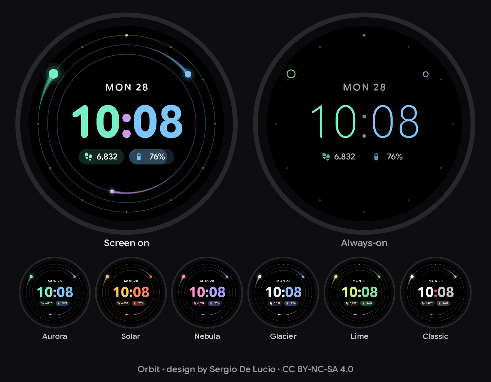

# Orbit: a watch face for Pixel Watch 4



Hours, minutes and seconds are shown as three glowing bodies circling the time. As in a real
solar system, the slowest one travels the widest orbit: hours on the outside, seconds on the
inside. In the middle is a large digital time, color-matched to its planets: hour digits in the
hour color, minute digits in the minute color, and the colon in the seconds color. Below the
time are two complication "chips". Chips that show progress, like battery or a step goal, fill
from left to right.

* **Format:** Watch Face Format v4, for Wear OS 6 and later (API 36). The Pixel Watch 4 ships
  with Wear OS 6. Watch Face Format files are resource-only APKs, so they contain no code.
* **Settings** (long-press the face, then tap **Customize**):
  * **Colors:** Aurora (default), Solar, Nebula, Glacier, Lime or Classic.
  * **Seconds:** Smooth (default), Tick, or Off. Tick and Off use less battery while the
    screen is on.
  * **Left / Right chips:** any complication you like. The defaults are Steps and Watch
    battery.
* **Always-on:** thin digits, planet outlines, the date and dimmed chips. Orbits, trails and
  the seconds planet are hidden.
* **Taps:** tap the time to open Alarms, or tap the date to open Calendar.
* **12h / 24h:** follows your watch setting. Single-digit 12-hour times like "9:41" stay
  centered.

## Download

Get the APK from the [latest release](https://github.com/Sergio99778/orbit-watchface/releases/latest).
The release .zip also includes the license files and install notes (in Spanish, with an English
summary). Orbit needs Wear OS 6 or later, like the Pixel Watch 4.

## Author and license

**Orbit** © 2026 by **Sergio De Lucio** is licensed under
[CC BY-NC-SA 4.0](https://creativecommons.org/licenses/by-nc-sa/4.0/). You may use, share and
adapt it for free if you give credit, but not for commercial purposes, and adaptations must be
shared under the same license.

* `LICENCIA.md`: plain-language summary and how to give credit (Spanish, with an English
  summary).
* `LICENSE`: the full legal code.
* `TERCEROS.md` and `LICENSES/`: the fonts and icons, which keep their own licenses.

Official builds are signed by the author. The certificate's SHA-256 fingerprint is
`97efa9149b89b5e8f079e81c01e1b8de8b9915c92400ac39a083acb698839a48`
(check with `apksigner verify --print-certs`).

## Install on your Pixel Watch 4

Faces from outside the Play Store are installed over wireless debugging (ADB). This takes
about five minutes the first time.

### 1. Turn on wireless debugging on the watch

1. Go to **Settings → System → About → Versions**. Tap **Build number** 7 times until it says
   you're a developer.
2. Go back to **Settings → Developer options**. Turn on **ADB debugging**, then
   **Wireless debugging**. The watch and your computer or phone must be on the same Wi-Fi.
3. Tap **Wireless debugging → Pair new device**. The watch shows a pairing code, an IP address
   and a port. Keep that screen open.

### 2a. From a computer (Windows, macOS or Linux)

Install Google's **SDK Platform-Tools** from developer.android.com/tools/releases/platform-tools.
It contains `adb`. Then run these commands in a terminal, from the folder containing the APK:

```sh
adb pair 192.168.1.23:37099        # IP:port from the "Pair new device" screen; type the code
adb connect 192.168.1.23:41235     # IP:port shown on the main Wireless debugging screen
adb install Orbit-watchface-1.1.1.apk
```

Note that the pairing port and the connect port are different numbers. You should see
`Success`.

### 2b. Or from an Android phone, no computer needed

Use an ADB installer app such as **GeminiMan WearOS Manager** or **Wear Installer 2**. Enter
the pairing code and IP from step 1.3, then choose *Install APK* and select
`Orbit-watchface-1.1.1.apk`.

### 3. Select the face

1. Long-press the current watch face and swipe to the end.
2. Tap **+ Add** and choose **Orbit**.
3. When you're done, turn off **Wireless debugging** again. It uses battery.

**Updating later:** install a newer APK with `adb install -r …`. It keeps your settings as
long as the new APK is signed with the same key as the installed one.

**Removing it:** run `adb uninstall app.orbit.watchface`, or uninstall **Orbit** in the watch's
Settings → Apps.

**If something looks wrong,** this shows the watch face runtime's log:
`adb logcat --pid=$(adb shell pidof -s com.google.wear.watchface.runtime)`

## About the always-on transition

Wear OS 6 has a known bug with third-party watch faces (Google issue 452423520). The fade
between normal and always-on mode can freeze halfway, so both layers show at once
("ghosting"). To avoid it, Orbit switches modes instantly: every ambient `Variant` has
`duration="0"`. If Google fixes the bug, you can set `FADE` in `tools/design.py` to something
like `duration="0.6" interpolation="EASE_IN_OUT"` for a smooth fade.

## Project layout

```
src/AndroidManifest.xml            package app.orbit.watchface, format v4, hasCode=false, min/target SDK 36
src/res/raw/watchface.xml          the watch face (generated - edit tools/design.py instead)
src/res/xml/watch_face_info.xml    picker metadata
src/res/values/strings.xml         names shown in the editor
src/res/font/                      Orbit Time Bold / Light, Orbit Label (see Fonts below)
src/res/drawable-nodpi/            preview.png (picker preview), ic_launcher.png
docs/preview.png                   the image at the top of this README
tools/design.py                    single source of truth: layout, colors, behavior -> XML
tools/build_fonts.py, fonts.json   builds the three font files from Google Sans Flex
tools/wffrender.py                 small WFF renderer used to draw previews from the real XML
tools/preview.py, grid.py, showcase.py, make_images.py   preview images
tools/lint_expressions.py          checks every [DATA_SOURCE] and function name against the spec
tools/zipalign.py                  4-byte alignment of stored entries (zipalign -p 4 equivalent)
build.sh                           compile -> link -> align -> sign -> verify
keystore/                          signing key; build.sh creates keystore/release.jks on first run
LICENSE, LICENCIA.md, TERCEROS.md  license (CC BY-NC-SA 4.0), summary, third-party notices
LICENSES/                          licenses of the bundled fonts and icons
```

## Rebuilding

You'll need the Android SDK (build-tools 36 and platform 36), Java 17 or later, and Python 3
with `fontTools`, `Pillow` and `lxml`.

```sh
python3 tools/design.py             # regenerate res/raw/watchface.xml and friends
python3 tools/make_images.py        # re-render preview.png and the icon (needs the font files below)
AAPT2=$ANDROID_HOME/build-tools/36.0.0/aapt2 \
ANDROID_JAR=$ANDROID_HOME/platforms/android-36/android.jar \
APKSIGNER=$ANDROID_HOME/build-tools/36.0.0/lib/apksigner.jar \
./build.sh                          # -> build/orbit-watchface.apk
```

`build.sh` signs with `keystore/release.jks` and creates that key the first time. To sign with a
key you already have, set `KEYSTORE`, `KEY_ALIAS` and `KS_PASS`. The author's release key is not
part of the source, so your builds can't install over the official APK (uninstall that first).

Before publishing a change, bump `VERSION_CODE` in `tools/design.py`. To validate, use the
official XSD validator (github.com/google/watchface, `third_party/wff`):
`java -jar wff-validator.jar 4 src/res/raw/watchface.xml`. Then run
`python3 tools/lint_expressions.py src/res/raw/watchface.xml 4`.

The tool scripts read these files through environment variables:

* `GSF_SRC`: the Google Sans Flex variable font, from github.com/google/fonts at `ofl/googlesansflex`.
* `SYMBOLS_FONT`: Material Symbols Rounded, used only for the mock complication icons in previews.
* `WFF_SPEC`: the spec `documents/` folder, used by the linter.

## Fonts and licenses

The three fonts in `src/res/font` are static, subset instances of **Google Sans Flex**, which is
licensed under the SIL Open Font License 1.1 (see `LICENSES/OFL-GoogleSansFlex.txt`). They use
the roundness axis at 100, and the time fonts use tabular figures. As modified versions they are
renamed "Orbit Time" and "Orbit Label", and they stay under the OFL, not CC BY-NC-SA. Google
Sans is a trademark of Google; Orbit is not affiliated with or endorsed by Google.

The sample complication icons in the preview images come from **Material Symbols Rounded**
(Apache License 2.0, see `LICENSES/Apache-2.0-MaterialSymbols.txt`).
